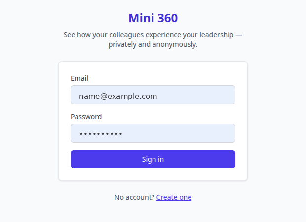
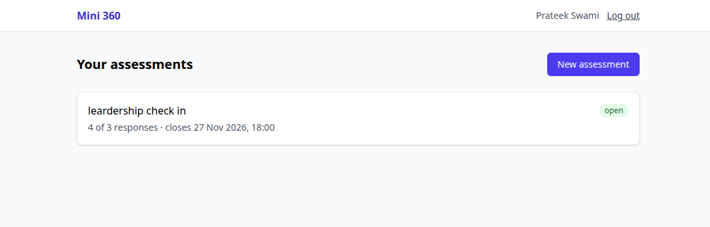
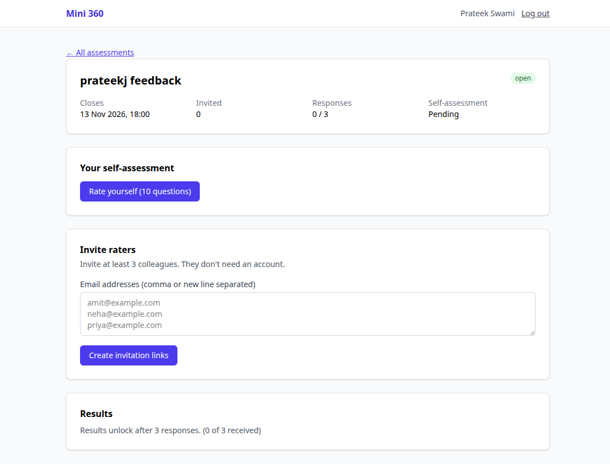
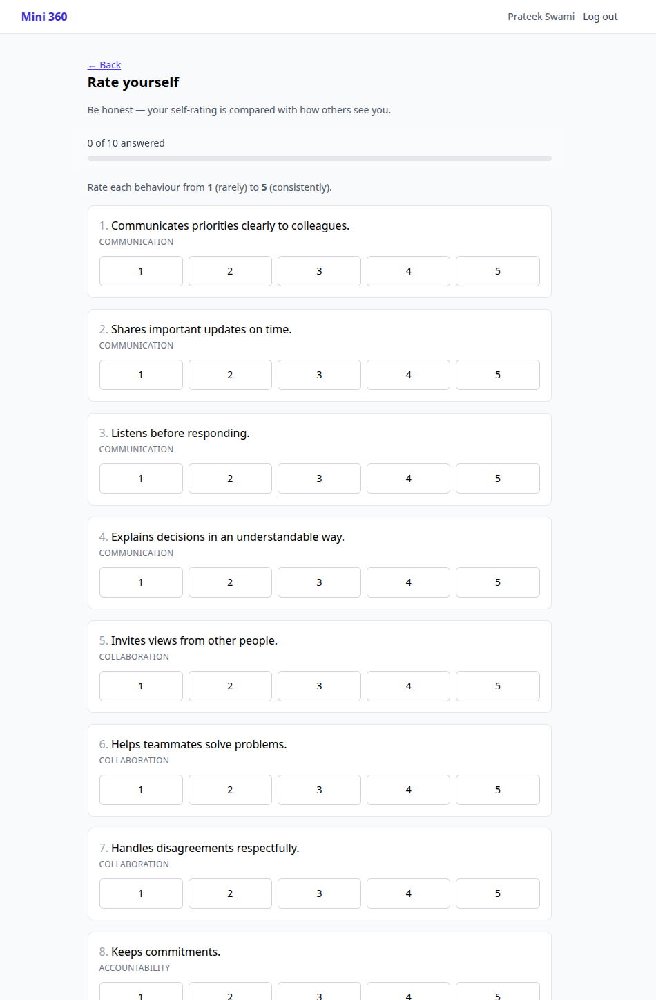

# Design notes

## User journey

Leader: register → create & launch assessment → self-assessment → invite 3+ raters → wait for closing date → results → commitments → PDF.
Rater: open link → introduction → 10 questions → thank-you page.

## Wireframes

Screens captured from the running app, kept in [`wireframes/`](wireframes/). Personal details in the screenshots are placeholders.

- [x] Login / landing — [`01-login.png`](wireframes/01-login.png)
- [x] Dashboard — [`02-dashboard.png`](wireframes/02-dashboard.png)
- [x] Invite raters — [`03-assessment-invite-results.png`](wireframes/03-assessment-invite-results.png)
- [x] Survey (self and rater) — [`04-self-assessment-survey.png`](wireframes/04-self-assessment-survey.png) (self-assessment only; rater survey not yet captured)
- [ ] Results — locked state only (bottom of `03-assessment-invite-results.png`); unlocked results screen not yet captured

