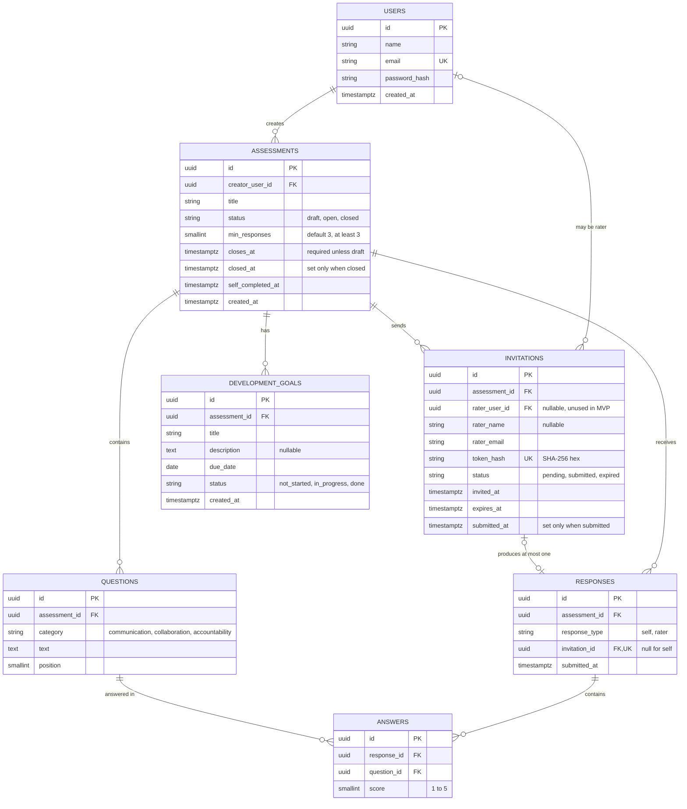

# ER diagram (final schema)

Generated from the SQLAlchemy models in `backend/app/models/` and the Alembic migrations.

## Database-enforced rules

| Table | Rule | Why |
|---|---|---|
| users | `email` unique (stored lowercase) | One account per email |
| assessments | `status IN ('draft','open','closed')` | Valid lifecycle only |
| assessments | Open or closed requires `closes_at` | A survey cannot launch without a closing date (FR-02) |
| assessments | `closed_at` set if and only if status is `closed` | Status and timestamp never disagree |
| assessments | `min_responses >= 3` | Anonymity threshold cannot be lowered |
| questions | unique `(assessment_id, position)` | No two questions in the same slot |
| invitations | `token_hash` unique | One link maps to one invitation |
| invitations | unique `(assessment_id, rater_email)` | A person is invited once per assessment |
| invitations | `submitted_at` set if and only if status is `submitted` | Consistent state |
| responses | `invitation_id` unique | An invitation submits at most once (FR-05) |
| responses | self ↔ no invitation, rater ↔ invitation | No guest response without a link |
| responses | partial unique index on `assessment_id` where `response_type = 'self'` | One self-assessment per assessment |
| answers | unique `(response_id, question_id)`, `score BETWEEN 1 AND 5` | PRD section 8 |

Foreign keys cascade on delete, except `invitations.rater_user_id` (`SET NULL`).

**Rule enforced in application code, not the database:** an answer's question must belong to the same assessment as its response (`services/responses.py`).

## Changes from the original ER draft

- Added `assessments.closes_at` (scheduled close) next to `closed_at` (actual close).
- Added `invitations.expires_at` (FR-05) and made `rater_name` nullable.
- Added `development_goals.due_date` and `status` (FR-08).
- Added the unique and check constraints listed above.
- Questions remain a per-assessment copy, as in the original draft (see `decisions.md`).
